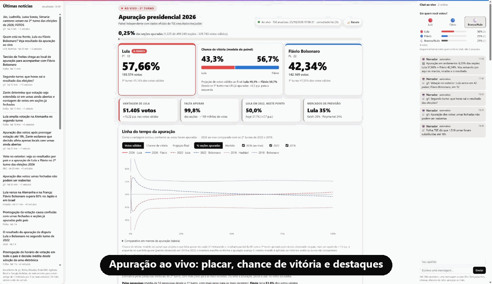

# Monitor Eleições 2026: President, runoff

**English** · [Português](README.pt-BR.md)

Live web dashboard for the vote count of Brazil's 2026 presidential runoff, built on official data from the TSE (Brazil's Superior Electoral Court) and compared with the 2022 and 2018 runoffs.

**Result:** Lula (PT) was elected with 51.78% of the valid votes (64,229,885 votes), against 48.22% for Flávio Bolsonaro (PL), with 99.96% of polling stations counted.

The dashboard ran on Fly.io on counting night (Oct 25, 2026) and was shut down after the result. The full series collected that night is in `data/seed/`, so you can see the dashboard as it ended by running it locally:

```bash
npm run serve      # without the collector: shows the final result at http://localhost:3000
```



The interface is in Portuguese. Features:

- **Live:** votes, % of polling stations counted and each candidate's chance of winning.
- **Timeline:** how the left and right candidates evolve as the count advances (valid votes, win probability or final projection), with 2026 overlaid on 2022 and 2018. The x-axis can be % of stations counted or time of day.
- **Regions:** where each candidate gained or lost ground compared with the first round, on a state tile map and in tables by region and state, for 2026, 2022 and 2018.
- **Count, votes and turnout by region:** % of stations counted in each region compared with the 2022 runoff at the same time of day; left × right in each region against the first round and 2022 (who is gaining, who is losing); and abstention in the stations counted so far, with the change from the 2026 first round and from 2022 (same weight per state), by region and state. Includes an estimate of total abstentions and the history of every round since 2018.
- **What each candidate needs to win:** weighted average of runoff polls, with more weight on recent ones. Shows how much the trailing candidate needs to gain in each region and the minimum the leader must hold. During the count, it also shows what share of the remaining votes each one needs.
- **Overseas votes by country:** per-station ballot box reports, published by the TSE as polls close abroad. Compares the first and second round in the same stations and puts 2018, 2022 and 2026 side by side, with votes gained and lost by country and city.
- **Live chat:** real-time messages (SSE), a filter against profanity, hate speech, threats and links, and an informal "who did you vote for" poll (🔴 Lula, 🔵 Flávio, ⚪ Blank/Null).
- **Latest news:** headlines from g1, Folha, Estadão, Poder360, Agência Brasil and Google News, filtered for the election and ranked by relevance. They sit in a left column on desktop and in a compact section on mobile.
- **Automatic narrator:** a clearly labeled bot (🤖, "automático" badge) posts count milestones to the chat (compared with 2022), lead changes nationally and in large states, sharp swings in win probability, the official result and major news. It does not vote in the poll. To turn it off: `NARRADOR=off`.
- **Prediction markets:** public prices from Kalshi (`KXBRPRES-26`) and Polymarket (`brazil-presidential-election`), normalized to a two-way race and compared with the dashboard's model through the night. Where the ISP blocks these domains (some do in Brazil), they show as unavailable; the dashboard does not get around blocks.
- **Responsive:** on mobile, the candidates sit side by side, the chart and map respond to touch, tables scroll sideways with a sticky first column, and the chat and news adapt.

No dependencies: all you need is Node 20 or newer.

```bash
npm start          # collector + server at http://localhost:3000
npm run collect    # collector only
npm run serve      # server only (reads what the collector wrote)
npm test           # chat filter tests
```

To deploy (Fly.io recommended), see **[DEPLOY.md](DEPLOY.md)** (in Portuguese).

## Structure

| File | Role |
|---|---|
| `server/index.js` | HTTP: static files, routes, security headers, gzip/ETag, cache, limits |
| `server/api.js` | route computations (live, timeline, regions, turnout, overseas, path to victory, news) |
| `server/collector.js` · `exterior.js` · `noticias.js` · `mercados.js` | collectors: TSE, overseas ballot box reports, news, prediction markets |
| `server/narrador.js` | automatic chat narrator |
| `server/chat.js` · `moderacao.js` | chat (SSE), poll, automatic and manual moderation |
| `server/config.js` · `ip.js` · `fsutil.js` | paths and environment variables, real client IP and limits, atomic writes |
| `shared/model.js` · `caminho.js` | win probability model and poll scenarios |
| `public/` | page: `app.js` (dashboard), `chat.js`, `noticias.js`, `style.css` |

## Data sources

| Data | Source |
|---|---|
| 2026 count (live) | `https://resultados.tse.jus.br/oficial/ele2026/6258/dados/<uf>/<uf>-c0001-e006258-u.json` |
| 2026 first round | same path, election `6257` (cached in `data/ref/t1-2026.json`) |
| 2022/2018 history | ballot box reports and votes by municipality/zone from the TSE Open Data Portal |

The collector polls Brazil and all 28 units (27 states plus overseas, `zz`) every 30 s. It sends `If-None-Match`, so the TSE answers 304 when nothing changed. Every change is appended to `data/live/snapshots.jsonl`. The TSE only publishes the current state, with no history: **the 2026 timeline only has the points collected while the collector was running.**

### History (`data/history/*.json`)

Built with `python -I scripts/build_history.py`, which downloads about 200 MB into `data/raw/`.

- **2022:** each station enters the timeline at the actual time its ballot box report was received (`DT_BU_RECEBIDO`). The curve matches the TSE's official totalization log (Lula takes the lead at ~67–68% of stations).
- **2018:** the reports have no reception time. It is estimated as the 2018 closing time of the voting machine plus the delay the same station had in 2022, so the arrival order follows 2022 logistics. In 2018, results were embargoed until 7 p.m.

## Win probability model (`shared/model.js`)

For each state, the uncounted vote is projected by blending the share already counted in that state with the state's first-round result (two-way), corrected by the observed national swing. There is also a +1.5 p.p. adjustment toward the left in the uncounted vote: in 2018 and 2022, the stations counted last leaned left. Uncertainty has a national and a per-state component, and both shrink as the count advances. P(win) comes from a normal approximation of the final margin.

It is a heuristic model, not an official forecast. The same model runs over the historical data, so the 2022 and 2018 curves show how it would have behaved on those nights:

```bash
node scripts/calibrate.js 0 0.01 0.015 0.02   # projection error by milestone, for each lateDrift value
```

## Other data

| File | Contents | How to build |
|---|---|---|
| `data/history/abstencao.json` | abstention by state and round, 2018 and 2022 | `python -I scripts/build_abstencao.py` (after `build_history.py`) |
| `data/history/exterior.json` | overseas votes by city and country, 2018 and 2022, both rounds | `python -I scripts/build_exterior.py` |
| `data/polls/2026-t2.json` | 2026 runoff polls (national and regional), with sources | collected by hand from news and Wikipedia |
| `data/ref/exterior-3220.json`, `data/live/exterior-3221.json` | overseas ballot box reports, 2026 first and second round | written by the collector |
| `data/chat/` | chat messages and poll votes | written by the server |

## Chat and moderation

The filter lives in `server/moderacao.js` and is built on word lists and patterns. Before checking, it normalizes accents, leetspeak, homoglyphs, invisible characters, repeated letters and words split into pieces. It blocks the whole message instead of masking it. Test cases run with `npm test`. No filter like this is foolproof; for whatever slips through, there is manual moderation with `ADMIN_TOKEN` (see [DEPLOY.md](DEPLOY.md)).

Limits:
- 1 message every 30 s per device and 6 every 30 s per IP
- up to 280 characters per message and 20 per nickname
- one poll vote per device (can be changed) and up to 5 devices per IP

**Behind a proxy or tunnel**, set `CLIENT_IP_HEADER` (`fly-client-ip` on Fly, `x-forwarded-for` on Railway, `cf-connecting-ip` on Cloudflare Tunnel) so limits use each visitor's real IP. On Fly and Railway this is detected automatically.

## Testing without waiting for the TSE

```bash
node scripts/simulate.js 80 0.6                              # simulated count up to 60%, in data/sim/
LIVE_DIR=data/sim PORT=3001 node server/index.js --no-collect
```
